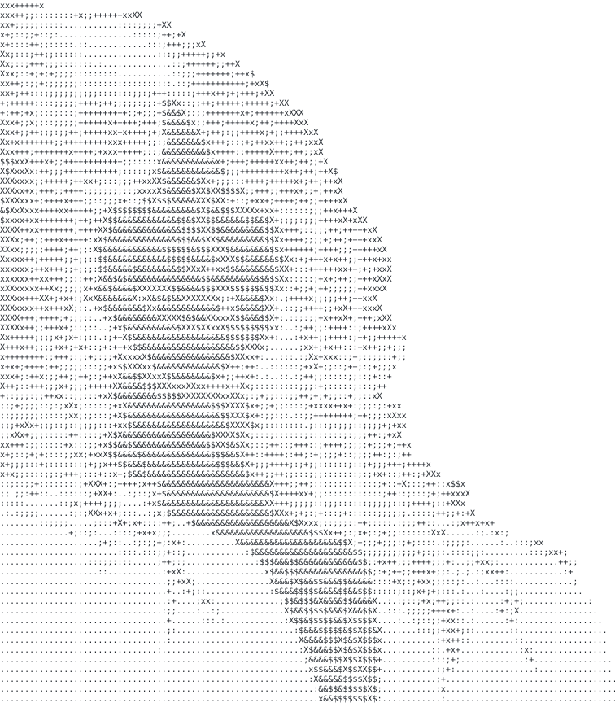

<table>
<tr>
<td valign="top">
 
ASCII art made with <a href="https://www.asciiart.eu/image-to-ascii">asciiart.eu</a>
</td>
<td valign="top">

# Hi, I'm Addi (＾▽＾)

Student at Saint Louis University.

## What I do
- Tech lead on [Mithridatium](https://github.com/oss-slu/mithridatium), an open-source ML security project with [OSS-SLU](https://github.com/oss-slu)
- Agentic system security engineer at [Unforge Inc.](https://unforge.io), building the [Auth51](https://auth51.com) security platform
- Agentic security research on access control and information flow control
- HPC research on PaRSEC (Python and Julia bindings)
- TA for Data Structures and Computer Systems
- Event chair for SLU Girls Who Code

## Get in touch
- Email: addison.thurston@slu.edu
- Site: [addithurston.com](https://addithurston.com)
- LinkedIn: [addison-thurston](https://linkedin.com/in/addison-thurston)

</td>
</tr>
</table>
